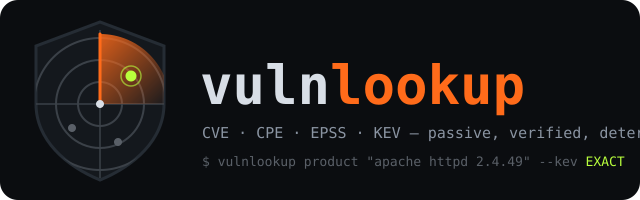

<p align="center">
  
</p>

<p align="center">
  <a href="https://github.com/offensiveadhd/vulnlookup/actions/workflows/tests.yml"></a>
  <a href="https://github.com/offensiveadhd/vulnlookup/actions/workflows/lint.yml"></a>
  <a href="https://github.com/offensiveadhd/vulnlookup/actions/workflows/skill-check.yml"></a>
  <a href="https://github.com/offensiveadhd/vulnlookup/actions/workflows/codeql.yml"></a>
  
  
  <a href="LICENSE"></a>
</p>

# vulnlookup

**A passive vulnerability lookup skill for AI agents. It scans nothing. It asks.**

Tell your agent what is running and it asks the NVD what is filed against that exact
version, re-checks every configuration node itself, scores the hits with EPSS, flags what
CISA says is exploited, classifies the exploit evidence in the references, and drafts the
remediation. The model decides *what you asked*; a deterministic, dependency-free script does
everything else, so two identical questions get two identical answers and nothing is ever
guessed.

One skill folder, installable into **Claude Code**, **Hermes Agent**, **OpenAI Codex** and
any agent that can run a shell command. The successor to
[SCAN 0.0](https://github.com/TikoTikTok/offensiveadhd-scan0), the browser version, with the
same engine ported to Python and the same rule: every false positive anyone finds becomes a
test.

<p align="center">
  
</p>

<p align="center"><sub>Recorded against the live APIs on 2026-11-01 with <code>docs/make-demo.py</code>. Also as <a href="docs/demo.mp4">MP4</a> and <a href="docs/demo.gif">GIF</a>.</sub></p>

## What it answers

| You say | The skill runs | You get |
|---|---|---|
| "what's CVE-2021-44228" | `cve CVE-2021-44228` | CVSS 10.0 with vector, EPSS 0.999 (percentile, date), KEV since 2021-12-10 with ransomware use, CWE, references with tags |
| "we run apache httpd 2.4.49, what hits us" | `product "apache httpd 2.4.49"` | 61 confirmed CVEs, each with the matched criteria and bounds (`EXACT [= 2.4.49]`, `RANGE [>= 2.4.7 < 2.4.52]`); 3 conditional records counted, 0 platform-only records shown |
| "…only the exploited ones, with a fix list" | `… --kev --poc --recommend` | the 3 KEV entries, exploit evidence (`exploited-in-the-wild`, Packet Storm, Exploit tags), fixed versions, patch and advisory links, the KEV deadline |
| "openssl CVEs 2019-2024 as markdown for the ticket" | `product openssl --years 2019-2024 --format md` | a Markdown table, published in those years only |
| "everything above httpd 2.0 that's in KEV" | `product "apache httpd" --version-from 2.0 --kev` | the KEV records whose vulnerable criteria reach 2.0 or later |
| "is log4j 2.99 affected" | `product "log4j 2.99"` | *version NOT in the NVD dictionary; typed as given* and whatever ranges still prove it. Nothing invented |
| "resolve gitlab" | `resolve gitlab` | one CPE when the alias table or an exact dictionary match settles it; otherwise exit 3 with ranked candidates and the agent asks you |
| a file of 40 CVE ids, a file of CPEs, a file of `name version` lines | `cve --file`, `bulk --cpes`, `bulk --products` | one section per subject; ambiguous lines reported, not guessed |

Every row carries CVSS (4.0 / 3.1 / 3.0 / 2.0, whichever exists, with the vector), EPSS
score and percentile, KEV status (`dateAdded`, `dueDate`, `knownRansomwareCampaignUse`),
CWE, published / last-modified dates and the NVD references with their tags. Filters compose
in one command: `--min-cvss`, `--severity`, `--min-epss`, `--kev`, `--ransomware`, `--cwe`,
`--years`, `--version-from`, `--sort`, `--limit`. Output is `--format
table|json|md|csv|brief` in `--style terse|analyst|executive`, switchable from the chat
("make that executive").

## Why it does not lie

The NVD's own matcher answers *yes or no*. vulnlookup asks it, then re-evaluates every
returned record against the NVD's configuration tree locally, because *why* is the whole
point:

| Verdict | Shown | Meaning |
|---|---|---|
| `EXACT` | yes | a vulnerable criteria names this exact version |
| `RANGE` | yes | inside a `versionStart…`/`versionEnd…` range the comparator can prove; the bounds are printed |
| `ANY` | yes | the criteria is `*` with no range: every version. Reported as such, not as "confirmed for yours" |
| `COND` | counted | matches, but the configuration is an `AND` with a platform you did not name ("when running on Windows"). `--on "windows 10"` resolves it |
| `MAYBE` | counted | the comparator will not guess: an unknown word (`4.av4`), a pre-release on a range boundary (`7.4.0 alpha1` vs `>= 7.4.0`), an update the record wants that you did not give |
| `PLATFORM` | never | your product appears only as `vulnerable: false`, the thing the real bug runs on. **This is where most CPE-based false positives come from** (CVE-2007-4723 names Apache httpd this way; a naive search reports it against every Apache) |
| `NVD-only` | counted | the NVD's matcher returned it and no node fits locally; counted so a disagreement can never hide a finding |

The version comparator is deterministic and documented
([references/cpe-matching.md](skills/vulnlookup/references/cpe-matching.md)): numbers
numerically, qualifier words by rank (`alpha < beta < rc < release < patch < sp < update`),
a letter glued to digits is a patch letter (`1.0.2k > 1.0.2j`) unless digits follow (`1.0a1`
is alpha 1), and anything resting on a word it does not know returns *uncertain*, which the
caller turns into `MAYBE` rather than a guess. Product names go through a 250-product alias
table (every pair verified against the NVD) and then the NVD CPE dictionary, and a single CPE
is returned only for an exact, unrivalled match. Versions are looked up in the dictionary and
used in the dictionary's spelling (`u5` → `update_5`, a deprecated entry → its replacement);
a version that is not there is kept as typed and announced.

## Install

```bash
# Claude Code
claude plugin marketplace add offensiveadhd/vulnlookup
claude plugin install vulnlookup@vulnlookup
# or copy skills/vulnlookup into ~/.claude/skills/ (personal) or .claude/skills/ (project)

# Hermes Agent
hermes skills install offensiveadhd/vulnlookup/skills/vulnlookup --category security

# Codex
npx skills add offensiveadhd/vulnlookup -a codex -g

# all three at once, detected on the machine
git clone https://github.com/offensiveadhd/vulnlookup
bash vulnlookup/install.sh          # --link to symlink, --project for project-level folders
pwsh vulnlookup/install.ps1         # Windows
```

Then `/vulnlookup <question>` (Claude Code, Hermes), `$vulnlookup` (Codex), or just ask:
the skill triggers on CVE / CPE / EPSS / KEV wording. Other agents: see
[AGENTS.md](AGENTS.md) for the contract and a prompt block.

Requirements: Python 3.10 or newer. Nothing else: the scripts are standard library only.

## Use it without an agent

```bash
S=skills/vulnlookup/scripts/vulnlookup.py
python $S cve CVE-2021-44228
python $S product "apache httpd 2.4.49" --kev --poc --recommend
python $S product openssl --years 2019-2024 --severity HIGH --format md
python $S product "apache httpd" --version-from 2.0 --kev --style executive
python $S resolve "log4j 2.14.1"
python $S bulk --products skills/vulnlookup/assets/products.example.txt --format csv > out.csv
python $S kev --recent 20
python $S epss CVE-2021-44228 CVE-2021-41773
python $S --help
```

Exit codes: `0` done · `1` error · `2` usage · `3` ambiguous product (candidates printed) ·
`4` nothing found · `5` offline and not cached.

### Speed and the key

The NVD allows 5 requests per rolling 30 s without a key and 50 with one. The script paces
itself and persists the window on disk so several processes share it, backs off on 403 / 429
/ 503, batches EPSS 100 ids at a time and caches everything (KEV 24 h, EPSS 24 h, CPE
dictionary 7 d, CVE results 6 h; `--ttl cve=1` overrides, `--offline` answers from the cache,
`cache stats|clear|path`). A product query is one or two NVD requests; a list of N CVE ids
is N requests, because the API has no bulk id lookup.

A key (free, [nvd.nist.gov/developers/request-an-api-key](https://nvd.nist.gov/developers/request-an-api-key))
is optional:

```bash
python $S key set            # reads the key from stdin; stored in Windows Credential Manager,
                             # macOS Keychain or the Secret Service; a 0600 file only as a last resort
python $S key status         # "present (…ab12, from credential-manager)"; never the key itself
python $S key clear
NVD_API_KEY=… python $S …    # the environment wins; CI and containers
```

The key is sent in the `apiKey` header to `services.nvd.nist.gov` and nowhere else, and never
reaches the cache, the output or the logs. Threat model in [SECURITY.md](SECURITY.md).

## Architecture

```
  you ──► agent (classifies the request: SKILL.md §1, one command) ──► vulnlookup.py
                                                                          │
            ┌─────────────────────────────────────────────────────────────┤
            │  vl/resolve.py   aliases.json ──► NVD CPE dictionary ──► one CPE, or exit 3
            │  vl/sources.py   NVD CVE API (virtualMatchString, paged)     ─┐
            │                  FIRST EPSS (batched)   CISA KEV (daily)      ├─► vl/cache.py
            │  vl/cpe.py       parse · compare versions · walk configurations · verdict + bounds
            │  vl/enrich.py    row = CVSS, EPSS, KEV, CWE, refs · exploit evidence · remediation
            │  vl/render.py    table | json | md | csv | brief  ×  terse | analyst | executive
            │  vl/http.py      pacing (5/50 per 30 s, shared on disk) · backoff · https only
            │  vl/keystore.py  NVD_API_KEY → OS credential store → 0600 file
            └─────────────────────────────────────────────────────────────┘
                     only CVE ids, CPE strings and product keywords ever leave the machine
```

The repository layout follows the Agent Skills format:

```
skills/vulnlookup/
├── SKILL.md                 the skill: intent table, filters, styles, the ambiguity protocol, verdicts
├── scripts/vulnlookup.py    the entry point; vl/ the engine (above)
├── references/              aliases.json · api-notes.md · cpe-matching.md · output-styles.md
└── assets/                  example input files for bulk
tests/                       pytest, offline against recorded fixtures; test_live.py opt-in
docs/                        test-cases.md · security-audit.md · demo.svg / demo.html · make-demo.py
AGENTS.md  SECURITY.md  CONTRIBUTING.md  install.sh  install.ps1  .claude-plugin/  .codex-plugin/
```

## Tests

```bash
python -m pip install pytest ruff
python -m pytest -q                       # ~175 tests, offline, ~30 s
python -m ruff check . && python -m ruff format --check .
python tests/check_skill.py               # the skill-format gate CI runs
VULNLOOKUP_LIVE=1 python -m pytest tests/test_live.py -q   # a dozen real requests
```

What is covered, prompt by prompt and case by case, is in
[docs/test-cases.md](docs/test-cases.md): every query kind, the ambiguity path, the
no-false-positive range checks (Ragnarok/Apache, OpenSSL letters, pre-release boundaries,
negated nodes, deprecated dictionary entries), output determinism (run twice, diff; cached and
uncached), the key-store paths. CI runs it on Ubuntu, Windows and macOS with Python 3.10 to
3.13, plus ruff, the skill-format check and CodeQL.

## Security

Three hosts, HTTPS GET only, nothing but CVE ids / CPE strings / product keywords in the
query string, no shell, no string-built URLs, no dependencies, no code from the network, no
writes outside the cache and config directories. The key handling is described above. The
full self-audit with file references is [docs/security-audit.md](docs/security-audit.md);
reporting is in [SECURITY.md](SECURITY.md).

## Limits, honestly

- **The NVD is the source.** A CVE with no CPE data (`Awaiting Analysis`, `Received`,
  `Deferred`) is invisible to every CPE matcher including this one. The NVD's enrichment
  backlog since 2024 is real. A `cve` lookup by id still works for those.
- **`ANY` records are trusted as written.** When the NVD says every version, so does the
  tool, with the verdict `ANY` so you can weigh it.
- **The comparator is deterministic; the data is not.** When they disagree the disagreement
  is a counted row (`NVD-only`, `MAYBE`), not a silence.
- **EPSS is a probability, KEV is a list.** Neither is proof of exposure; `--poc` is evidence
  found in the references, never a verdict on exploitability, and says so in every output.
- **`--recommend` is a checklist from the record** (fixed versions implied by
  `versionEndExcluding`, Patch and Vendor Advisory links, the KEV deadline), not vendor
  guidance.
- **Platforms.** No platform given means `COND` stays `COND`. Add `--on "windows 10"` and it
  resolves.
- **Rate limits are the NVD's.** A long list of CVE ids takes minutes unkeyed; the skill
  tells the model to say so first.

## License

MIT. Not affiliated with NIST, FIRST or CISA, which they would confirm. Part of the
[Offensive ADHD](https://github.com/offensiveadhd) lab.
